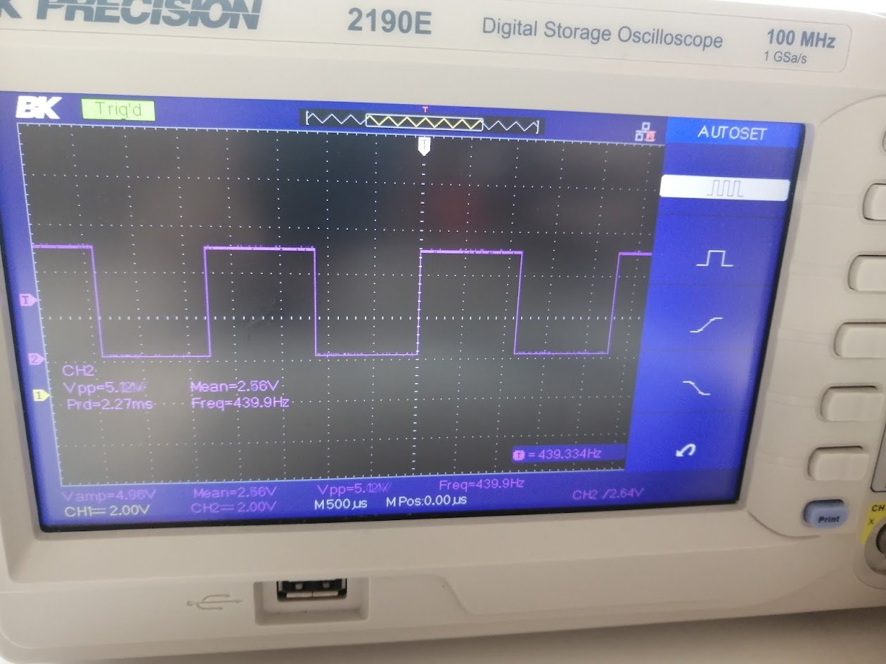
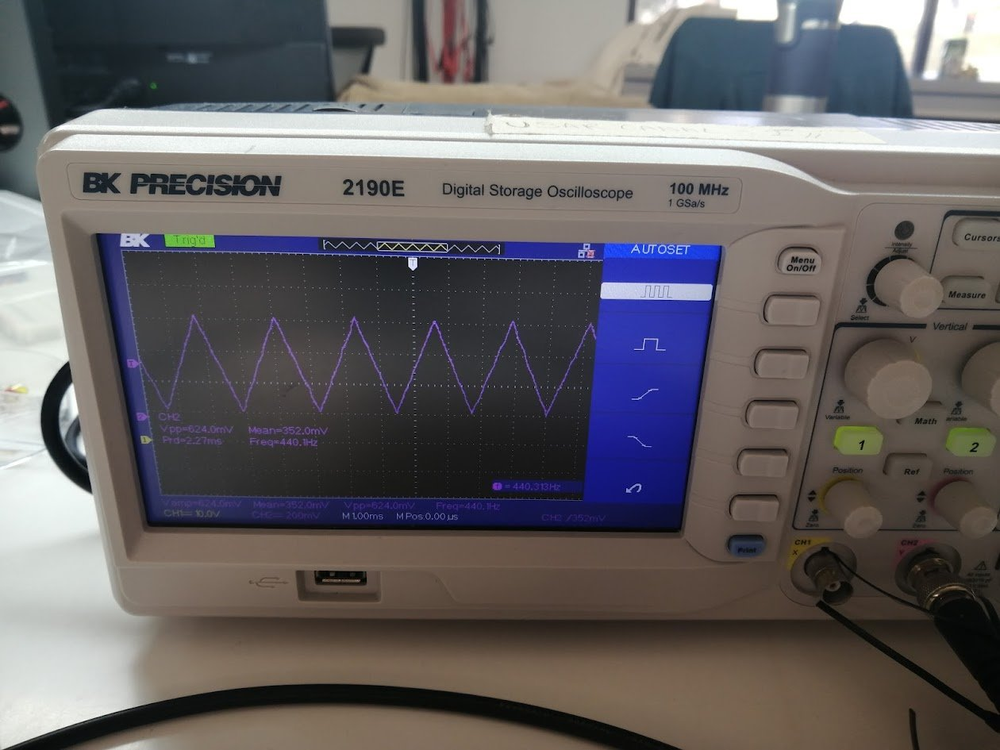
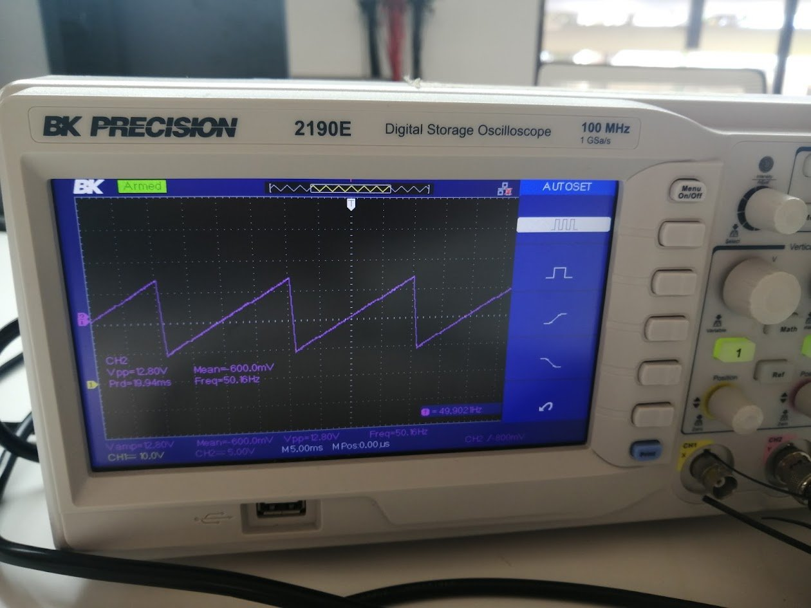
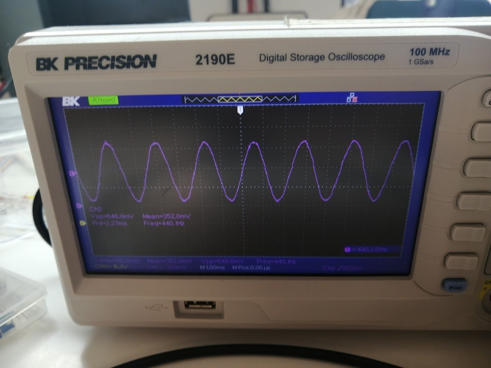
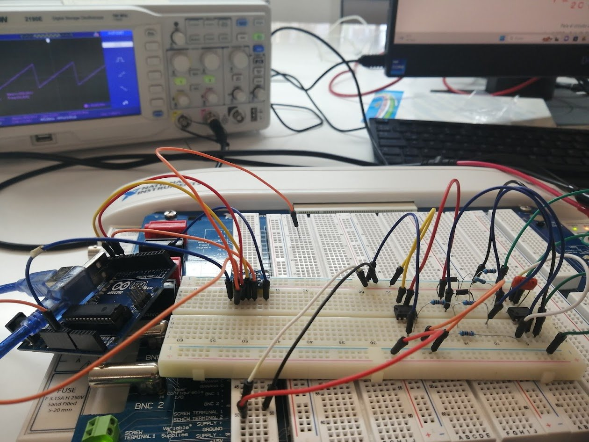

# AD9833-Signal-Generator-Arduino
# Arduino Signal Generator (AD9833 + Op-Amp Sawtooth)

University project for **Signal Analysis and Communication Systems** (ULACIT, III term 2023, final project delivered December 22, 2023). I built the circuit, wrote the Arduino code and measured every waveform on an oscilloscope.

## What it does

An Arduino drives an **AD9833 DDS chip over SPI** to generate three waveforms. A fourth waveform, the sawtooth, comes from a separate **op-amp comparator circuit** that takes the square wave as its input.

| Waveform | How it is produced |
|---|---|
| Square | AD9833, selected in code |
| Triangular | AD9833, selected in code |
| Sine | AD9833, selected in code |
| Sawtooth | Analog circuit with op-amp comparators (not generated by the code) |

All four waveforms were checked on a BK Precision 2190E digital oscilloscope (photos below).

## How the waveform is selected

The sketch generates one waveform per upload. In class, I changed the waveform in the `setWave` line, re-uploaded the code, and checked the new signal on the oscilloscope. In `SignalGenerator/SignalGenerator.ino` this is the `WAVEFORM` setting at the top.

## Results

| | |
|---|---|
|  Square wave (AD9833) |  Triangle wave (AD9833) |
|  Sawtooth wave (op-amp comparator circuit) |  Sine wave (AD9833) |

*Arduino connected to the AD9833 (square, triangular, sine) and the op-amp circuit that produces the sawtooth.*

## Hardware

- Arduino board
- AD9833 DDS signal generator module (SPI, chip select on pin 10)
- Operational amplifiers used as comparators (sawtooth circuit)
- Breadboard, oscilloscope for measurement

## Requirements

The sketch only produces a signal when an **AD9833 module is wired to the Arduino** (SPI, chip select on pin 10 in this sketch). With nothing connected, the Arduino just prints the startup information on the serial monitor. The code itself compiles without the hardware, as long as the AD9833 library is installed.

## Run it

1. Install the **AD9833** library by Rob Tillaart in the Arduino IDE.
2. Open `SignalGenerator/SignalGenerator.ino`.
3. Set `WAVEFORM` to `AD9833_SINE`, `AD9833_SQUARE1` or `AD9833_TRIANGLE`.
4. Upload it and connect the AD9833 output to the oscilloscope.

## Notes and limitations

- The code in this repository is a **cleaned-up version** of the class code. I fixed variables that were not defined in my original file. It has not been re-tested on the hardware since.
- The waveform is selected by editing the code, not through the serial monitor. The serial output only prints the startup information.
- The sawtooth is analog, and its circuit values are not documented here.
